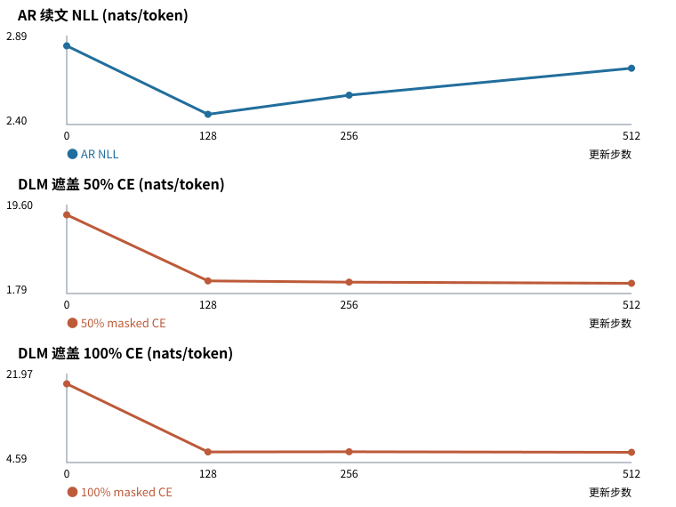
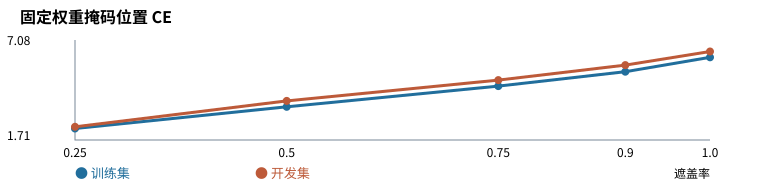

# 构建扩散语言模型：从掩码训练到生成诊断

项目位置：https://github.com/HuangBlac/DiffusionLLM

## 1. Introduction：项目要回答什么问题

本项目关注扩散语言模型的训练与生成，探索如何通过掩码去噪学习文本续写，以及这种生成方式能否利用并行预测带来实际的推理收益。

自回归语言模型（AR）从左到右逐词续写；掩码扩散语言模型（DLM）则从待填写的续文画布出发，多轮预测并逐步填入token。DLM一轮可以预测多个位置，但同轮预测看不到彼此的新结果，可能产生前后冲突。计算上，AR可以通过KV缓存复用已有前文；DLM的双向注意力使画布更新影响已有位置的表示，难以直接复用AR的增量缓存。因此，并行填词的潜力能否转化为速度收益，需要同时考察生成质量与计算开销。

为复用预训练模型的语言能力，本项目以Qwen2.5-0.5B Base为起点，将其改造为双向掩码去噪模型，并以同基座AR为对照，重点考察两个问题：

- 训练时借助可见参考词学到的去噪能力，能否用于从全掩码开始、逐步依赖自身输出的开放续写？
- 一轮填入更多词是否更容易产生前后冲突？增加轮数、每轮少填几个词，能否以可接受的耗时改善续写？

单种子各512步运行中，DLM开发集掩码损失明显下降，生成仍有重复、残句和过短续文。报告围绕这一差距展开，结合固定权重下的生成比较、遮盖率扫描与配对上下文探针，分别检查揭示粒度、高遮盖预测和自生成上下文下的表现，为后续控制实验明确问题。

## 2. Mechanics：掩码如何变成生成过程

以下以512步学习运行为主，依次说明训练输入、去噪目标、模型改造与多轮生成。重点是明确训练与生成时可见信息的差别，以及每轮填词数量与计算量的关系；早期LoRA先导的设置在3.1另述。

### 2.1 从自回归分解到吸收态前向加噪

设分词后的文本序列为 $x = (x_1, \ldots, x_n)$。AR模型按从左到右的顺序建模，每个位置的预测以其左侧前缀为条件。由概率链式法则，序列概率可写为：

$$p_\theta(x_1, \ldots, x_n) = \prod_{i=1}^{n} p_\theta(x_i \mid x_{<i})$$

训练时，因果注意力限制每个位置只能读取自身及左侧token，并用该位置的隐状态预测下一个token。生成时，模型每步生成一个新token，再将其加入前文；KV缓存保存已有前文在各层的键和值，避免后续步骤重复计算。

DLM通过逐步恢复被遮盖的词来生成文本。为定义这一去噪任务，先考虑相反方向的前向加噪过程：保持前文可见，将参考续文中的词逐步替换为`[MASK]`。

例如，将参考续文“猫/坐/在/垫子/上”视为五个示意token，一次遮盖可能得到“猫 `[MASK]` 在 `[MASK]` 上”。在同一条前向加噪轨迹中，一个位置一旦变为`[MASK]`，就保持该状态，因此称`[MASK]`为吸收态。

令$t\in[0,1]$表示连续的噪声水平。在线性调度$\alpha_t=1-t$下，每个目标位置保留原词的概率为$1-t$，被遮盖的概率为$t$。记受损输入为$x_t$；给定$t$，各目标位置独立遮盖，其条件分布为：

$$
q_t((x_t)_i\mid x_i)=
\begin{cases}
t, & (x_t)_i=\mathrm{MASK},\\
1-t, & (x_t)_i=x_i,\\
0, & \text{其他情况}.
\end{cases}
$$

因此，目标续文区域的联合分布为：

$$
q_t\big((x_t)_{\mathrm{target}}\mid x_{\mathrm{target}}\big)
=
\prod_{i\in\mathrm{target}}q_t((x_t)_i\mid x_i).
$$

前文始终保持不变。当$t=0$时，目标续文完整保留；当$t=1$时，目标续文全部被遮盖。训练时先为每条样本采样$t$，再按上述分布生成受损输入，无需逐步模拟整条加噪轨迹。例如，$t=0.5$意味着每个目标位置各有一半概率被遮盖，单次采样的遮盖数量不必恰好占目标长度的一半。

调节$t$改变了可见参考续文的预期比例，为比较模型在不同参考信息条件下的预测能力提供了统一描述。下一节定义实际训练采用的噪声范围，以及模型如何从这些受损输入中学习恢复原词。

### 2.2 变分下界（ELBO）与时间重加权训练目标

上一节定义了受损输入$x_t$，本节进一步说明如何训练模型恢复原词。扩散生成模型将中间去噪状态作为潜变量，直接计算文本概率需要对可能的去噪路径求和。训练可以转而最大化对数似然的变分下界（ELBO）。

在标准掩码扩散的相应反向参数化与端点条件下，连续时间的负ELBO可写为不同噪声水平下原词交叉熵的加权期望，推导见[MDLM §3.3–3.5](https://arxiv.org/html/2406.07524v2#S3.SS4)。本项目借用这一时间加权形式，实际采用的噪声范围与损失定义如下。

在线性调度$\alpha_t=1-t$下，交叉熵的时间权重为：

$$
w(t)=-\frac{\alpha'_t}{1-\alpha_t}=\frac{1}{t}.
$$

本项目对每条样本从$t\sim\mathrm{Uniform}[0.1,1)$采样，再独立遮盖目标续文中的各个位置。该设置将时间权重限制在10以内，同时截去了低噪声区间，因此实际适配目标与完整区间上的负ELBO有所区别。

记真实续文目标的长度为$L$，包括其中的自然`EOS`；$m_i=1$表示目标位置$i$被遮盖，否则为0。给定受损输入$x_t$，单条样本的训练损失为：

$$
\widehat{L}(\theta)
=
\frac{1}{Lt}
\sum_{i\in\mathrm{target}}
m_i\big[-\log p_\theta(x_i\mid x_t)\big].
$$

其中，$m_i$选出需要恢复的目标位置，$1/t$施加时间权重，$1/L$按目标长度归一化。批次内各样本损失再取算术平均。

给定$t$，被遮盖目标数的期望为$Lt$，因此上述缩放也可理解为按期望遮盖数归一化；按本次实际遮盖数取平均则是另一种目标。独立遮盖可能未选中任何目标，其概率为$(1-t)^L$，此时该样本的损失为0。

DLM训练与推理均使用128格的续文画布。训练时，前文始终可见，只在真实续文目标内随机遮盖，并计算被遮位置的损失。保留自然段落结尾的样本将`EOS`纳入目标；达到长度上限时直接截断，不在截断处补`EOS`。实际目标之后的剩余画布槽位固定填充为`[MASK]`后缀。这些后缀位置参与双向注意力，但不作为预测标签。

开发评价在固定遮盖率下计算掩码交叉熵（Masked CE）：汇总所有样本被遮目标位置的交叉熵，再除以实际被遮盖的目标token总数。自然`EOS`被遮盖时计入统计，固定MASK后缀始终排除。该指标按目标token汇总平均，与训练时的时间加权、逐样本长度归一化分别报告。后续采用50%与100%遮盖条件，比较不同参考词可见程度下的预测表现。

### 2.3 模型架构改造：双向注意力与 Shift 对齐继承

本项目使用Qwen2.5-0.5B Base的预训练参数初始化DLM，沿用原模型的词嵌入、旋转位置编码（RoPE）和Transformer层。512步学习运行采用全参数适配，原模型参数与新增MASK向量均参与更新。改造包括三个方面：

1. **MASK输入表示。** 为被遮位置引入一个可训练向量，替换该位置原有的token嵌入。被遮位置的原词用于监督预测，未遮住的参考词仍作为可见上下文。

2. **双向注意力。** 去除因果注意力的从左到右限制，使每个位置都能读取前文与整块续文画布，包括可见的参考词或生成词，以及MASK槽位。

3. **shift输出对齐。** 延续AR的预测位置关系，用位置$i-1$的隐状态预测位置$i$的token；改为双向注意力后，继续使用这一输出对齐。其初始化动机也见于[Dream的AR初始化](https://arxiv.org/html/2508.15487v1#S4.SS1)。作为对照，same对齐用位置$i$的隐状态预测同一位置的token，两者的先导比较见第3.1节。

上述改造得到2.2训练目标中的预测器$p_\theta(\cdot\mid x_t)$；如何反复调用这个预测器完成生成，在2.4中说明。

### 2.4 从单步去噪到多轮迭代生成

训练步按参数更新计数，本次训练通过梯度累积完成更新。生成时则固定模型参数，每轮预测并更新续文画布。本项目采用$K\in\{16,32,128\}$轮迭代，过程如下：

1. **初始化画布。** 在给定前文之后拼接128个`[MASK]`槽位，作为待生成的续文区域。

2. **预测并填词。** 每轮将前文与当前画布输入模型，计算所有未填位置的词表分布。贪心解码选择各位置概率最高的词；随机解码按温度为1的分布抽取候选词。随后，以各候选词的概率作为位置置信度，按本轮配额选出置信度最高的一部分位置填入。新填词成为下一轮的可见上下文，已填位置在后续轮次保持不变。对128格画布，16、32、128轮分别对应每轮填入8、4、1个位置。

3. **提取输出。** 完成全部$K$轮后，若画布中包含`EOS`，截取位置最靠前的`EOS`之前的文本；否则保留全部128个token。当前实现不会因中途填入`EOS`而提前结束迭代。

上述生成过程将引言中的两个研究问题具体化为以下比较：

1. **参考词预测如何用于开放续写。** 训练时，未遮住的续文来自参考文本；随机遮盖也可能产生全遮盖目标。生成则每次从全掩码续文画布开始，随后依赖模型自己填入的词，且当前解码不会修正已填位置。因此，后续用遮盖率扫描检查不同参考信息条件下的预测表现，再用配对上下文探针对照生成词与参考词作为上下文时的预测差异。

2. **每轮填词数量如何影响输出与耗时。** 较少轮数意味着同轮固定更多候选词，而这些预测都依据填词前的画布，可能前后不协调。增加轮数让后续预测更频繁地利用新填词，同时也增加前向计算次数。当前实现每轮重算前文与整块画布，完整迭代后才按EOS截断，因此需同时记录续文表现、最终交付长度和完整生成耗时。后续固定模型权重与候选词选择方式，比较每轮少填词带来的生成变化及其计算代价。

## 3. Experiment：从小试验到可恢复训练

### 3.1 对齐与揭示粒度的先导实验

先导实验分别检查输出对齐和每轮填词数量。2026年11月1日，两组模型从同一Qwen2.5-0.5B Base预训练参数开始，使用相同的样本顺序与遮盖，分别进行shift和same对齐的LoRA掩码训练，各更新200步。两组掩码交叉熵均下降，固定提示下的生成仍有重复。

随后分别冻结两个检查点，在12条固定提示上，以贪心方式比较每轮填入1个与8个位置。该诊断固定生成32个token并屏蔽EOS，分别需要32次与4次前向计算。两个检查点上，每轮填8个位置时，相邻重复率更高，测得耗时更低。

这些观察提示，参考词预测的改善与实际续写需要分别评价，每轮填词数量的影响也应通过固定权重对照考察。后续512步学习运行保留shift对齐，并加入同基座AR对照，分别记录开发预测指标、生成表现与耗时。

### 3.2 从计算完成到检查点恢复

全参数试运行先验证参数更新与保存恢复，再将AR和DLM从20步续至200步。该阶段出现存储刷新失败，初始AR200的云端文件未通过完整性核验；DLM200当时仅有服务器摘要核对，缺少检查点的独立恢复证据。后续实验据此将参数更新完成、服务器保存和独立恢复分别验收。

改进后的流程先在训练机器本地原子保存并保留独立快照，再经正式Drive API上传。服务器文件大小与摘要匹配后，完整下载检查点，在独立CPU进程中恢复模型、Adam优化器及CPU端随机状态，并运行有限值推理。

这套流程先在AR40恢复点上通过验证，再用于40→200续训；新AR200检查点约5.93GB，并通过独立CPU恢复。后续512步学习运行沿用这套保存与恢复验收流程，从共同基座重新开始训练。

### 3.3 固定配方学习运行

2026年11月7日，AR与DLM分别独立加载同一Qwen2.5-0.5B Base预训练参数，各进行512次全参数更新。两组共用4,096条训练样本、种子11及相同的样本索引序列，有效批次为16，由微批次2、梯度累积8组成。

两组均使用AdamW，前20步将学习率线性预热至$2\times10^{-5}$，随后保持不变。前文长度为128 token，续文长度上限为128 token；DLM采用2.2所述的固定画布与MASK后缀策略。上述设置统一了更新次数与样本曝光，计算成本另行测量。

在适配前的0步基线及128、256、512步评价点上，使用同一批100条开发样本。AR测量续文条件NLL；DLM分别测量50%与100%遮盖条件下的交叉熵和Top-1原词恢复准确率，并在各评价点复用固定遮盖种子。两类损失的条件信息不同，分别用于观察各自的学习变化。

AR512与DLM512的终点检查点均完成独立下载与CPU恢复，覆盖模型、优化器及CPU/采样随机状态，并通过有限值推理检查。CUDA随机状态随检查点保存，GPU状态重放尚未实施。

| 更新步 | AR续文 NLL | DLM 50%遮盖 CE | DLM 50% Top-1 | DLM 100%遮盖 CE | DLM 100% Top-1 |
| ---: | ---: | ---: | ---: | ---: | ---: |
| 0 | 2.8295 | 17.5459 | 0.59% | 19.9684 | 0.05% |
| 128 | 2.4541 | 4.3139 | 28.00% | 6.6669 | 3.05% |
| 256 | 2.5587 | 4.0747 | 30.84% | 6.6970 | 2.82% |
| 512 | 2.7065 | 3.8435 | 34.53% | 6.5955 | 4.08% |

Top-1将被遮目标中预测正确的token数除以被遮目标总数。50%条件的分母为3,064个目标，100%条件为5,959个；计入被遮盖的自然EOS，排除固定MASK后缀。100%条件仍保留前文，仅遮住全部续文目标。

四个评价点中，AR NLL在128步最低，随后回升，终点仍低于适配前基线。DLM在50%条件下的CE逐点下降，Top-1从0.59%升至34.53%；100%条件的CE在前128步明显下降，此后变化较小，终点Top-1为4.08%。两种参考信息条件呈现出不同的恢复表现。

这些单步指标以参考词为评价对象。下一节直接观察实际续写，检查生成行为与这些预测指标之间的对应关系。

## 4. Results and Diagnosis：从生成行为到可检验诊断

### 4.1 生成样例与固定提示评价

为观察单步预测指标改善后的实际续写表现，在同一组8条固定开发提示上，使用AR512与DLM512进行贪心生成，设备为L4。DLM分别采用16、32和128轮解码。

长度与耗时按提示取平均；相邻重复率将全部交付文本中的相邻相同token对数除以相邻token对总数。AR使用KV缓存并在生成EOS时停止；DLM完成全部设定轮次后，再按画布中位置最靠前的EOS截取交付文本。

| 模型与揭示轮数 | 平均交付长度（token） | 相邻重复率 | 平均耗时（秒） |
| --- | ---: | ---: | ---: |
| AR512 | 25.75 | 0.00% | 0.912 |
| DLM512，16轮 | 19.25 | 37.67% | 0.608 |
| DLM512，32轮 | 17.00 | 12.50% | 1.144 |
| DLM512，128轮 | 15.12 | 0.88% | 4.433 |

同一提示的一组样例中，AR512输出`recording a new album as a surprise for her fans .`；DLM512在16轮输出`recording recording material for a  22210 . .`，32轮输出`recording recording material for Love Again World the following 01 .`，128轮输出`recording Love Again .`。这些片段展示了重复、异常数字和短终止；它们来自模型输出，未作盲评。

在这8条提示上，K从16增至128时，相邻重复率下降，交付文本变短，生成耗时上升。相邻重复率反映局部重复，应结合输出片段与交付长度解读；质量匹配下的速度关系仍待测量。下一节进一步检查高遮盖预测和自生成上下文条件下的表现，分析参考词恢复与实际续写之间的差距。

### 4.2 冻结权重的双探针

2026年11月8日，冻结DLM512权重，在CPU上以FP32完成两类诊断，分别检查高遮盖预测与自生成上下文条件下的表现。

**遮盖率扫描。** 按内容哈希从训练集和开发集各取32条样本，在25%、50%、75%、90%、100%遮盖率下计算CE。遮盖率从25%升至100%时，训练集CE从2.328升至6.146，开发集从2.416升至6.458。高遮盖条件下较高的参考词预测损失，在训练样本中也同样出现。

**配对上下文探针。** 在8条固定提示上，以温度1按随机顺序逐位置揭示。每到指定揭示点，将已揭示且具有参考词的位置替换为参考词；其他输入、遮盖位置与剩余计分目标保持一致，再比较两种上下文下的CE。

揭示16、32、48个画布位置后，按剩余参考目标token加权的“生成−参考替换”CE差分别为1.725、2.849、3.673 nats/token，对应剩余目标总数为515、448、381；每个揭示点均为8/8提示的生成上下文CE较高。

这些差值描述指定上下文条件下的参考词预测差异。参考替换提供了真实词及可能的EOS信息，合理续文也可能偏离单一参考；各揭示点的计分目标又有所变化，因此差值增长不能直接解释为错误逐步累积。该探针采用随机逐位置轨迹，主生成则采用分批置信度揭示，两者的生成条件也需分别解释。

### 4.3 下一步要分别检验的问题

上述观察对应以下候选控制实验：

1. **沿训练进度定位两类差异。** 在128、256、512步权重上复用相同样本、遮盖与画布条件，运行同一套诊断，检查参考词辅助下的预测改善，是否伴随全遮盖预测及自生成上下文表现的改善。

2. **检验后缀政策与终止行为。** 训练时，A只允许注意力读取实际前文及续文目标位置，B还允许读取结束后的MASK后缀。控制共同基座、样本、噪声及更新次数，评价时统一画布与可见信息。现有512步结果来自B，后缀政策对EOS与交付长度的作用需要通过这项成对对照检验。该试验记为P2，现有执行记录尚无可核验的真实参数更新。

3. **分别检验采样修正与计算优化。** 重掩码检查修改已填词能否改善输出；缓存复用检查减少重算后的质量与耗时变化。两者分别设置对照，统一提示、输出条件与质量口径，并记录额外前向次数和完整生成耗时。

回到引言，本次单种子适配改善了参考词预测，开放续写仍有退化；增加轮数伴随相邻重复减少、交付变短与耗时上升，等质量的速度优势尚未建立。后续控制实验应分别检验高遮盖学习、自生成上下文和终止行为，并将生成变化与计算代价一并评价。

## 数据与复查

实验记录截至2026年11月8日，文字修订于2026年11月11日。详细指标与诊断定义见[阶段结果](docs/history/learning-run-results-2026-11-08.md)，生成样例与统计口径见[生成评价数据](results/learning-generation-summary-2026-11-07.json)；运行配置、保存恢复记录、源码及后续方案统一由[文档索引](docs/README.md)进入。

项目负责人提出问题、设计实验对照并参与原理梳理与结果讨论；代码实现、运行和检查由Codex辅助。
