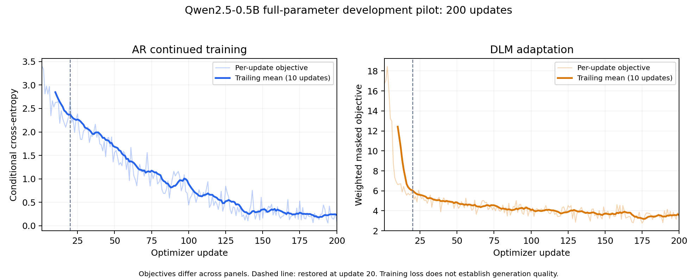

# 两组200步计算完成，AR200检查点未可靠保存

> 历史实验／过程档案：正文状态、预算与操作指令仅对应文中日期，不作为现行执行依据。2026-11-06整理后的当前状态见[项目进度](../progress.md)，P2执行约束见[P2规程](../current/p2-readiness-2026-11-05.md)。原始测量和失败证据保留。

2026-11-03用户批准P1累计上限4→8 CU，在原12 CU筛选额度内调配，总180 CU不变。本轮从已保存的第20步恢复，DLM和AR均完成第200步及规定评估；原20步历史前缀一致，训练脚本/数据/基座/优化器配置身份检查保留。

但端到端保存尚未完成：最终`flush_and_unmount(timeout_ms=45000)`报错，随后运行时被释放。不能以计算阶段的`completed`或挂载内摘要通过，替代云端最终状态已保存。

## 同一批32个验证样本上的结果

| 指标 | 第20步 | 第200步 |
| --- | ---: | ---: |
| AR条件交叉熵，nats | 2.48660 | 3.54748 |
| AR原词预测准确率 | 48.81% | 44.87% |
| DLM 50%掩码交叉熵（非NLL），nats | 5.29059 | 4.43199 |
| DLM 50%掩码原词准确率 | 16.99% | 30.12% |
| DLM 100%掩码交叉熵（非NLL），nats | 7.03930 | 6.90668 |

AR训练目标下降至第200步约0.0896，同时留出集变差，表现出过拟合迹象。原始AR在同32样本上的交叉熵为2.66562；因此本轮200步AR的泛化指标也差于原始模型。这里是单种子、观察过的开发小测，不作完整独立测试结论。

DLM在部分词可见时的预测有改善，全掩码改善较小。查看的续写仍有明显重复和循环短语。32前文×16/128轮共64条生成：按每条续文相邻相同token比例再取均值，16轮约74.45%，128轮约32.60%；平均解码时间约1.28秒和9.55秒。此重复指标不能检测所有循环短语，不是校准的语言质量评分，也不能把两种训练目标的数值横向比较。

曲线显示实际200步历史，虚线标记第20步恢复边界。两面板的训练目标不同，不比较绝对高低。尚未调用DeepSeek裁判、运行成熟7B评测或完成正式多种子研究；AI辅助实验记录不代表本人独立掌握。

## 证据与检查点

- 控制目录：`MyDrive/DiffusionLLM/runs/p1-20261103T102930Z-6b4ad195/p1-20261103T111743Z-f8c5fd03/`。
- 两份`report-20-200.json`均已从Drive外部读回本地，并与阶段清单逐项核对大小/SHA-256。原始报告保存在`private/runs/p1/training-reports/`；原始笔记本`private/runs/p1/resume-200-actual-20261103.ipynb`保留了同步报错。
- 运行内最终`verify_receipt`通过，AR/DLM检查点都计算过摘要；这是挂载内检查。
- DLM200预期及外部列出大小均为5,928,802,759字节，预期摘要`e14383cba153d088573f1c1ff7c314a808985482a18d6b93e0304e977d8f7ea0`。未完整下载约6GB文件，不声称完成会话外全文件摘要核对。
- AR200预期5,928,790,871字节，预期摘要`b0ca648f8fc8544136d7f2178cc8bb74ff1e9352cf74423c937f6238a33a0378`；云端当前列出5,928,777,943字节，与预期不符。Drive版本记录仅显示原始20步文件及一份较早续训文件，不能当作200步检查点。
- Drive连接器拒绝下载约6GB文件（上限256 MiB），Drive网页也无法预览。已准备CPU只读检查，使用`weights_only=True,mmap=True`读取实际保存步数、历史长度和身份，不更新权重。已尝试启动，但前端连接反复恢复；保存笔记本的检查单元execution_count为null、outputs为空，不能声称已读取检查点内部步数。当前已核0会话，后续须恢复可靠连接再检查，不把文件大小推测当作已验证步数。

## 收尾修复及后续约束

已修复预留时间不可用于完整同步的问题：训练保留0.5 CU，独立释放请求保留0.1 CU计费余量，间隔用于有界刷新，并额外留30秒发起释放。所有时限锚定同一开始时刻，刷新超时随实际剩余时间缩短；刷新失败明确报告，不在卸载后写入原挂载路径。新增7项收尾行为测试通过，相关组合21项通过及ruff通过，独立Python复核无未解决阻断。

修复后本地全套68项测试通过。当前证据只确认45秒配置下刷新失败；未证明延长等待必能解决，也未证明独立看门狗导致了这次失败。

这只是本地验证过的预防修复，不会恢复已丢失的AR200缓存，也不能保证Drive必在新时限内完成。检查尝试后最新已实读0活动会话/0 CU每小时，余额185.72 CU；P1起点193.05至此账面差额7.33 CU计入8 CU上限（含历史失败和CPU），剩余0.67 CU。未追加GPU训练或扩大预算。

下一步先确认云端AR可恢复步数，再确定恢复方案；当前不能直接声称可从AR200续训。公开数值回执为`results/p1-200-results-2026-11-03.json`。
